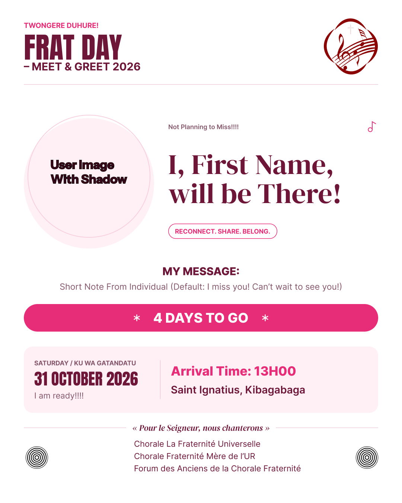

# Frat Day Flyer Studio

A browser-only flyer maker for the Chorale La Fraternité **Frat Day** reunion.
Personalize the artwork, add a portrait, see every change live, and download a
print-ready PNG.



## What it does

- Live 1080 × 1350 flyer preview that updates as you type.
- First-name personalization in the headline and download filename.
- Optional photo upload with drag-and-drop, validation and crop controls.
- Automatic countdown and English/Kinyarwanda weekday from the event date.
- Three color stories: Classic, Midnight and Evergreen.
- PNG export at 1× (1080 × 1350), 2× (2160 × 2700) or 3× (3240 × 4050).
- Fully client-side: photos and text never leave the browser.

## Stack

React 19, TypeScript, Vite 7, `html-to-image`, Fontsource fonts (Anton,
Montserrat, Playfair Display), Vitest and Playwright.

## Getting started

Requires **Node.js 20.19 or newer** (see `.nvmrc`).

```bash
npm ci
npm run dev
```

Open <http://127.0.0.1:5173>.

### Scripts

| Command             | Purpose                                      |
| ------------------- | -------------------------------------------- |
| `npm run dev`       | Start the Vite development server            |
| `npm run build`     | Typecheck and build the production site      |
| `npm run preview`   | Preview the production build locally         |
| `npm run lint`      | Run ESLint                                   |
| `npm run typecheck` | Run the TypeScript compiler                  |
| `npm test`          | Run the Vitest unit suite                    |
| `npm run test:e2e`  | Run the Playwright end-to-end suite          |

## Deployment

The workflow at `.github/workflows/deploy.yml` builds and deploys the site to
GitHub Pages on every push to `main`.

1. Push the repository to GitHub.
2. Open **Settings → Pages**.
3. Set **Build and deployment → Source** to **GitHub Actions**.
4. Push to `main` or run the workflow manually.

The Vite base path is inferred from `GITHUB_REPOSITORY`, so the project works at
`https://<owner>.github.io/<repository>/` without edits. To deploy somewhere
else, set `VITE_BASE_PATH` (for example `/my-folder/`) when building.

## Customizing

- Default copy, organizer names and field limits live in `src/data/defaults.ts`.
- Palettes live in `src/data/themes.ts`.
- Flyer geometry and typography live in `src/flyer.css`.
- The flyer logo is an inline SVG in `src/assets/flyer-logo.svg`.
- The original artwork and measurements are in `reference/`.

The headline supports `[First Name]` as a placeholder. Empty optional fields
(quote and organizers) are simply omitted from the flyer.

## Photo rules

JPG, PNG and WebP files up to 10 MB are accepted. Images are read with
`FileReader`, decoded in the browser, and drawn through a CSS `object-position`
crop. Nothing is uploaded.

## Testing

```bash
npm test
```

For end-to-end tests, install Playwright's browser once:

```bash
npx playwright install chromium
npm run test:e2e
```

If a system Chrome is available and the bundled browser cannot be downloaded,
point Playwright at it:

```bash
PLAYWRIGHT_EXECUTABLE_PATH=/usr/bin/google-chrome npm run test:e2e
```

The e2e suite starts its own dev server on port 5173 and verifies live editing,
theme and size changes, photo upload, PNG dimensions, validation and reset.

## Troubleshooting

- **Node version errors:** Vite 7 requires Node 20.19+. Run `nvm use`.
- **`npm ci` peer resolution issues:** retry with `npm ci --legacy-peer-deps`.
- **Missing Rollup/Esbuild binary:** delete `node_modules` and reinstall on the
  target platform; do not copy `node_modules` between machines.
- **Export fails on Safari:** try the latest Safari, then 1× or 2× if memory is
  constrained.
- **Wrong Pages asset paths:** rebuild with the correct `VITE_BASE_PATH`, or let
  the GitHub Actions workflow infer it.

## Project structure

```text
src/
  components/       Flyer, editor, photo panel and controls
  data/             Default copy and color themes
  lib/              Countdown, filename, photo and content helpers
  flyer.css         Print/flyer layout
  styles.css        App shell and editor styling
e2e/                Playwright flows
tests/              Vitest unit tests
reference/          Original flyer artwork
.github/workflows/  GitHub Pages deployment
```
